<picture>
  <source media="(prefers-color-scheme: dark)" srcset="./assets/header-dark.svg">
  <source media="(prefers-color-scheme: light)" srcset="./assets/header-light.svg">
  
</picture>

  <a href="mailto:charani51015@gmail.com">Email</a>&nbsp;&nbsp;·&nbsp;&nbsp;<a href="https://linkedin.com/in/sri-naga-charani">LinkedIn</a>&nbsp;&nbsp;·&nbsp;&nbsp;<a href="https://abstain-kappa.vercel.app">Abstain demo</a>&nbsp;&nbsp;·&nbsp;&nbsp;<a href="https://levi-v2-lebhn9g2ds8wwdvg34yhkn.streamlit.app/">Levi demo</a>&nbsp;&nbsp;·&nbsp;&nbsp;<code>open to 6-month SDE / AI Engineer internships</code>

I close the gap between *the model works in a notebook* and *the model works at 2 a.m. under real traffic*. Final-year CS undergrad at IIIT Kota. I've built LLM evaluation frameworks as an intern at **Ethara AI** and work on fMRI-based autism classification with **Dr. Bhavna Bajpai**. The throughline: don't ship a model — ship a system you can trust, measure, and debug.

 

<picture>
  <source media="(prefers-color-scheme: dark)" srcset="./assets/metrics-dark.svg">
  <source media="(prefers-color-scheme: light)" srcset="./assets/metrics-light.svg">
  
</picture>

<picture>
  <source media="(prefers-color-scheme: dark)" srcset="./assets/divider-dark.svg">
  <source media="(prefers-color-scheme: light)" srcset="./assets/divider-light.svg">
  
</picture>

## <code>01</code>&nbsp; Selected work

**[Abstain — chargeback decisions that know when not to decide](https://github.com/cherry51015/Abstain)**
An LLM reads dispute evidence but never touches the money. Rules extract facts first, and the LLM is called only for documents the rules can't read; its answers must quote the source verbatim or they're discarded. A bootstrap ensemble turns facts into P(win) ± uncertainty, and a deterministic policy picks CONTEST, CONCEDE or ESCALATE by expected value. It escalates to a human only when their answer is worth their time. Async API with an append-only audit trail and idempotency keys. Every concession comes with the minimal evidence that would flip it.
 `FastAPI` `PostgreSQL` `SQLAlchemy/Alembic` `asyncio` `NumPy` `Prometheus` `Docker` · [live demo](https://abstain-kappa.vercel.app) · [API docs](https://abstain-api.onrender.com/docs)

<picture>
  <source media="(prefers-color-scheme: dark)" srcset="./assets/abstain-flow-dark.svg">
  <source media="(prefers-color-scheme: light)" srcset="./assets/abstain-flow-light.svg">
  
</picture>

**[Levi — legal document Q&A with cited evidence](https://github.com/cherry51015/levi-v2)**
Every claim cites the exact passage it came from, and weak evidence triggers a refusal before any LLM call. Hybrid BM25 + vector search, reciprocal rank fusion and a cross-encoder reranker. On CUAD contracts: 86% hit@5, 0 of 24 made-up claims, 18 of 19 unanswerable questions correctly refused. The 12× smaller reranker beat the bigger one at a tenth of the latency. Runs at $0 on free tiers behind retries, a per-model circuit breaker and a fallback chain.
 `FastAPI` `Qdrant` `BM25` `bge` `cross-encoder` `Langfuse` `Docker` · [live demo](https://levi-v2-lebhn9g2ds8wwdvg34yhkn.streamlit.app/)

<picture>
  <source media="(prefers-color-scheme: dark)" srcset="./assets/levi-flow-dark.svg">
  <source media="(prefers-color-scheme: light)" srcset="./assets/levi-flow-light.svg">
  
</picture>

**[Trello clone — Kanban backend](https://github.com/cherry51015/trello-clone)**
Built end-to-end in a two-day intern assignment. Fractional indexing so a drag-and-drop reorder writes one row instead of renumbering a list. FastAPI + PostgreSQL API with optimistic updates on the client.
 `FastAPI` `PostgreSQL` `React`

**[Agent-Translator](https://github.com/cherry51015/Agent-Translator)**
Multi-agent translation of academic documents (DOCX, PDF, TXT) that preserves equations, tables and layout. Hierarchical agents with a self-correcting QA loop, deployed on ECS.
 `CrewAI` `Python` `AWS ECS`

<picture>
  <source media="(prefers-color-scheme: dark)" srcset="./assets/divider-dark.svg">
  <source media="(prefers-color-scheme: light)" srcset="./assets/divider-light.svg">
  
</picture>

## <code>02</code>&nbsp; Research

> **LLM-Based Framework for ASD Prediction and Individual Biomarker Identification from Resting-State fMRI Functional Connectivity**
> with Renu Rawal, Kunja Anusri and Dr. Bhavna Bajpai
>
> BrainNetCNN on ABIDE-I (570 subjects, Schaefer-400 atlas), mean AUC **0.793**. A two-stage explainability pipeline turns GradientSHAP attributions into Yeo-7 network scores, then into per-subject biomarker narratives with Llama-3.3-70B.

> **From Tool Use to Autonomy** — co-authored PRISMA systematic review of agentic LLMs (46 sources). Notes live in the Agentic-LLMs repo.

<picture>
  <source media="(prefers-color-scheme: dark)" srcset="./assets/divider-dark.svg">
  <source media="(prefers-color-scheme: light)" srcset="./assets/divider-light.svg">
  
</picture>

## <code>03</code>&nbsp; Toolkit

<table>
<tr><td width="170" valign="top"><b>Retrieval&nbsp;&amp;&nbsp;LLMs</b></td><td valign="top">Qdrant · FAISS · BM25 · cross-encoder rerankers · LangChain · LangGraph · LlamaIndex · CrewAI · MCP · Amazon Bedrock</td></tr>
<tr><td width="170" valign="top"><b>Backend</b></td><td valign="top">Python · FastAPI · asyncio · PostgreSQL · SQLAlchemy/Alembic · Docker · Prometheus</td></tr>
<tr><td width="170" valign="top"><b>ML</b></td><td valign="top">PyTorch · TensorFlow · Hugging Face · XGBoost</td></tr>
<tr><td width="170" valign="top"><b>Cloud</b></td><td valign="top">GCP (Cloud Run) · AWS (ECS, Bedrock) · Render · Vercel</td></tr>
</table>

<picture>
  <source media="(prefers-color-scheme: dark)" srcset="./assets/divider-dark.svg">
  <source media="(prefers-color-scheme: light)" srcset="./assets/divider-light.svg">
  
</picture>

## <code>04</code>&nbsp; Experience

<table>
<tr><td width="170" valign="top"><code>ONGOING</code></td><td valign="top"><b>Research, IIIT Kota</b> with Dr. Bhavna Bajpai — ASD classification from resting-state fMRI</td></tr>
<tr><td width="170" valign="top"><code>INTERNSHIP</code></td><td valign="top"><b>AI Intern, Ethara AI</b> — built LLM evaluation frameworks; benchmarked generative output</td></tr>
<tr><td width="170" valign="top"><code>OCT&nbsp;24&nbsp;–&nbsp;JAN&nbsp;25</code></td><td valign="top"><b>ML Engineer, Fox Trading</b> — feature pipelines on daily market indicators; LSTM + XGBoost ensemble for forex direction</td></tr>
<tr><td width="170" valign="top"><code>OPEN&nbsp;SOURCE</code></td><td valign="top"><b>LangChain</b> — RAG guardrails and retrieval refinement</td></tr>
</table>

 

Fig. 1 in the header is a real top-k query: the highlighted points are the five nearest neighbours of the query point.
